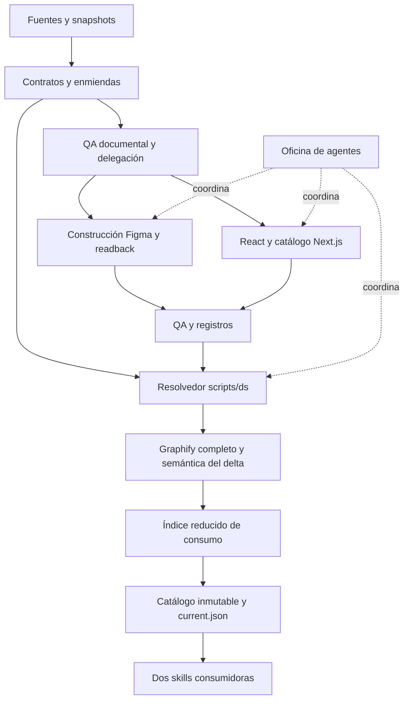

# Blue Heart DS · Auditoría de arquitectura del proyecto original

Fecha: 26 de octubre de 2026 · Estado: diagnóstico y recomendaciones, sin implementación.

Proyecto examinado: `/Users/miguel.leo/Desktop/CONTPAQi-designSystem-Optimizado`.

**Dictamen:** el proyecto tiene una disciplina sólida de procedencia, preservación y QA, pero su arquitectura operativa está demasiado ligada a la historia de reconstrucción. El siguiente sistema debe conservar esa disciplina y reducir la dependencia de documentos históricos, reconstrucciones globales e interpretación repetida por agentes. Copiar el repositorio y cambiarle el nombre trasladaría esos costes a Blue Heart DS.

La prioridad es separar **norma vigente, evidencia histórica, implementaciones, distribución y navegación**. La extracción semántica y la oficina de agentes no deberían ser requisitos para resolver un contrato o consumir una versión ya validada.

## Alcance y método

Se examinó la arquitectura de todos los subsistemas identificados: protocolos, contratos, tokens, scripts, catálogo web, adaptaciones Figma, skills, Graphify, distribución GitHub y oficina de agentes. Se recorrieron los inventarios, se inspeccionó código de los caminos críticos y se verificaron hashes contra comprobantes existentes. Se estudiaron con mayor detalle Button, Toggle, Select, Header, Conversation, foundations y las excepciones de tipografía/Slots.

Esta es una auditoría arquitectónica amplia; **no es una nueva certificación funcional de las 43 familias ni una lectura semántica exhaustiva de cada archivo histórico**. Se distinguen:

- **Comprobado:** observado directamente en archivos, código o verificaciones de esta auditoría.
- **Registrado:** resultado que afirma un reporte anterior, cuya ejecución no se repitió.
- **Inferencia:** conclusión arquitectónica sustentada por lo anterior, pendiente de ensayo cuando implica rendimiento futuro.
- **Propuesta:** decisión recomendada para Blue Heart DS; todavía no adoptada ni implementada.

No se ejecutaron cierres, generadores, instalaciones, servidores, publicaciones, escrituras en Figma ni suites que construyen artefactos en el original. Se ejecutaron el benchmark de lectura existente sobre una copia de consumo ya presente y las funciones de validación documental sobre las rutas del último plan, con `-B` y sin activar caché de escritura. Sus resultados se guardaron fuera del original. Los SKILL.md se analizaron como artefactos del sistema, sin activar sus flujos de construcción.

No se consultó Figma en vivo ni el remoto GitHub. Las afirmaciones sobre ellos se limitan a adaptadores, snapshots y comprobantes locales. La documentación externa enlazada por el original no se tomó como validación actual de APIs o versiones.

**Preservación comprobada al terminar:** HEAD y estado Git permanecieron idénticos. En los 73,130 archivos regulares inventariados no hubo altas, bajas ni cambios de tamaño/mtime; los hashes verificados contra manifiestos también coincidieron. Esta comprobación tiene las exclusiones del inventario descritas abajo y no pretende ser una imagen forense de todo el disco. Solo se crearon documentos de auditoría y resultados de análisis en Blue Heart DS, además de archivos temporales fuera del original.

Resultados consultables: [manifiesto de evidencia](</Users/miguel.leo/Desktop/Blue Heart DS/auditoria/2026-10-26/evidencia-auditoria.json>), [verificación documental](</Users/miguel.leo/Desktop/Blue Heart DS/auditoria/2026-10-26/verificacion-documental.json>) y [benchmark de consumo](</Users/miguel.leo/Desktop/Blue Heart DS/auditoria/2026-10-26/benchmark-consumo.json>).

## 1. Estado de referencia y magnitudes

| Dato | Observación | Interpretación correcta |
|---|---:|---|
| HEAD local | `41ab4c0bf4197ef0a5b1dda73c7a6be81c818933` | Último commit local: 7 de octubre; no representa por sí solo todos los archivos auditados. |
| Estado Git inicial | 34 modificados fuera del índice, 673 bajas en el índice, 16,450 archivos sin seguimiento | Cambios preexistentes. Las bajas pueden conservar archivo físico; no se interpretaron como pérdida. |
| Archivos regulares inventariados | 73,130 | Excluye `.git`, `node_modules`, `__pycache__`, `.next` y enlaces simbólicos. Incluye otros almacenes y derivados. |
| Tamaño lógico inventariado | 8,549,174,718 bytes, aproximadamente 8.55 GB | No equivale a tamaño de Git, espacio físico recuperable ni consumo de contexto. |
| `graphify-out/` | 6.08 GB; 5,908 archivos | 5.84 GB corresponden a `runs/`; el grafo activo pesa 47.45 MB. |
| `output/` | 1.82 GB; 46,908 archivos | `output/skills/` ocupa aproximadamente 1.02 GB. Hay releases, copias verificadas y evidencia, no solo caché. |
| Protocolos | 8 fases y P-SLOTS; 106,515 bytes | No deberían cargarse todos por defecto. AGENTS ya recomienda lectura selectiva. |
| Vista de estado | 49 identidades; 48 resueltas y 1 candidata | Incluye otras entidades además de componentes web. No confundir con 49 componentes. |
| Estados de las bases seleccionadas | 44 `DELEGATED_FOR_BUILD`, 4 `APPROVED`, 1 sin base elegible | Delegación no implica defecto ni aprobación humana. |
| Registro web | 43 familias; 90 referencias a enmiendas | Entre 1 y 6 enmiendas por entrada, además de herencia y datos vinculados. |
| Ubicación de bases web | 39 en `specs/`, 4 en `drafts/` | La carpeta no determina vigencia; aumenta la necesidad de un resolvedor fiable. |
| Enmiendas independientes en la vista | 73 | No significa 73 errores; son documentos no agrupados como enmienda de una familia en esa vista. |
| Catálogo de consumo | 2,221 archivos; 62,606,990 bytes originales; 9,495,932 bytes comprimidos | Descarga/copia amplia aunque el agente necesite pocas familias. |
| Índice de consumo | 311,526 bytes; 331 documentos; 905 relaciones; 291 entradas de tokens; 43 familias cubiertas | Cobertura de raíces contractuales, no prueba de completitud semántica ni de todos los tokens del DS. |

Se verificó en esta auditoría:

- Coincidencia de los hashes de las **2,473 fuentes** enumeradas en el último `source-plan.json`.
- Coincidencia de los **8 outputs** acreditados por `ds-closure.json`.
- Grafo con **14,253 nodos y 34,042 aristas**, sin IDs duplicados ni endpoints ausentes.
- Coincidencia de las **1,577 referencias de hash** de la vista derivada y de los **2,221 archivos** del manifiesto del catálogo.
- Hash correcto del manifiesto y del bundle del catálogo, y del inventario de tokens protegido.
- Coincidencia de las herramientas referidas por el comprobante del índice de consumo.
- Validación documental sobre esas 2,473 rutas: **PASS**, con 1,172 JSON, 279 documentos YAML/frontmatter y 4 metadatos de prosa comprobados. La regeneración del estado **en memoria** coincidió exactamente con la vista guardada. Se conservaron 21 hallazgos históricos y 4 advertencias; detalle en `verificacion-documental.json`.

Estos controles acreditan integridad del conjunto enumerado. No sustituyen una nueva detección completa de cobertura, QA semántico, acceso remoto ni prueba de reconstrucción desde un clon limpio. La etiqueta `CURRENT` del cierre es histórica; no se emitió un cierre nuevo.

## 2. Arquitectura actual

El repositorio funciona como un monolito de conocimiento y herramientas con cinco capas mezcladas en el mismo ciclo de mantenimiento:

| Capa | Artefactos principales | Responsabilidad efectiva |
|---|---|---|
| Evidencia y procedencia | `sources/`, snapshots, inventarios, `archive/` | Conservar lo observado y recibido. |
| Norma y decisiones | `specs/`, parte de `drafts/`, `registry/`, protocolos | Definir contratos elegibles, excepciones y autoridad por alcance. |
| Implementaciones | `implementations/figma/`, `implementations/web/` | Scripts específicos de reconstrucción Figma y biblioteca React con catálogo Next.js. |
| Derivación y distribución | `scripts/ds*`, `catalog/`, `skills/`, `output/skills/` | Resolver estado, generar documentación, empaquetar contenido y motores. |
| Navegación y operación | `graphify-out/`, `office/`, servidor local | Grafo, consulta dirigida, registro de agentes y despacho de nuevas ejecuciones Codex. |

La separación conceptual está documentada mejor que su aislamiento técnico. Por ejemplo, `ds_core.corpus()` importa el detector de Graphify incluso para consultas de estado; el generador web invoca ese resolvedor. Por otra parte, preparar el índice de consumo exige que el grafo completo pase su gate. Así, una dependencia de navegación alcanza la generación documental y la distribución.

## 3. Qué conviene preservar

1. **Autoridad explícita y acotada.** Los datos observados, inferencias y decisiones se distinguen. Un grafo o una captura no aprueban diseño. Una enmienda sustituye únicamente el alcance identificado.
2. **QA documental separado de QA de implementación.** P06 exige revisar contra fuentes y leer el destino después de escribir. La respuesta de creación no se considera verificación.
3. **IDs lógicos separados de IDs Figma.** P04 preserva origen, destino, modos, aliases y bindings reales. Evita que igualdad de color se confunda con equivalencia semántica.
4. **Composición comprobable.** P-SLOTS distingue contenido variable de una colección fija o de un frame llamado Slot; exige pruebas desde la instancia consumidora.
5. **Cortes inmutables y caché verificada.** El catálogo se identifica por hash, las skills fijan un corte por encargo y el cargador rechaza rutas inseguras, symlinks y contenidos adulterados.
6. **Cierre reanudable y coordinación de escritores.** `ds_close.py` y `ds_session.py` ya evitan reconstrucciones concurrentes y reutilizan resultados. No se recomienda reemplazarlos por una cola distribuida más compleja.
7. **Honestidad de métricas.** Los tokens no observables se registran como `UNAVAILABLE`; el uso de cuenta no se atribuye ficticiamente a una tarea.
8. **Pruebas negativas relevantes.** Se encontraron tests de conflicto, integridad, corrupción de caché, rollback de publicación local, pérdida de endpoints y protección frente a éxito parcial. Esos escenarios son activos de migración.

## 4. Hallazgos prioritarios

### H01 · Alta · El commit local no identifica el estado auditado

**Comprobado.** HEAD es del 7 de octubre y existe un conjunto amplio de cambios locales. El comprobante `catalog/prepared/consumption-proof.json` registra ese mismo `source_commit`, mientras sus hashes describen el contenido local posterior. Los hashes son coherentes; el commit aislado no reconstruye ese contenido.

**Consecuencia.** Una herramienta que use solo `source_commit` como clave de reproducibilidad, recuperación o comparación puede seleccionar un estado diferente. No se afirma que el remoto carezca de esos cambios: no se inspeccionó.

**Recomendación.** Definir la identidad de un corte con manifest de contenido, commit cuando corresponda, estado de limpieza y versiones de herramientas. La futura importación a Blue Heart debe partir de un snapshot explícito, no de “clonar HEAD” ni de “tomar lo último”. Evidencia: E02, E10.

### H02 · Alta · La norma vigente requiere recomponer demasiada historia

**Comprobado.** Button combina base 0.2.0, herencia 0.1.0, YAML técnico y seis enmiendas declaradas en el registro web. Toggle conserva base vigente en `drafts/`. Header, Modal, Sidebar y App Shell carecen de frontmatter y requieren parsing especial de prosa. Hay 6 relaciones de prosa y 6 selectores de contexto fijados por hash en configuración, además de 21 excepciones de enlaces históricos.

**Consecuencia.** El sistema necesita reglas especiales para interpretar su propia historia. Los agentes vuelven a resolver precedencia y alcance; un cambio editorial puede invalidar selectores que están ligados al documento completo. Esto no prueba contradicciones en cada familia, pero sí una superficie de mantenimiento frágil.

**Recomendación.** Una entrada vigente por identidad y destino, con trazabilidad hacia requisitos históricos. Mantener enmiendas como historial de cambios y publicar una vista efectiva comprobada. No aplanar requisitos ni elegir por fecha o mayor versión. Evidencia: E03–E06, E12.

### H03 · Alta · El índice necesario para consumir el DS depende de un grafo mucho más amplio

**Comprobado.** P05/P08 y `ds_consumption.prepare()` exigen Graphify `CURRENT` antes de producir el índice. Sin embargo, la proyección pública acepta relaciones `references/cites` con evidencia `EXTRACTED`, confianza 1, línea verificable y enlace real; descarta texto semántico libre. Secciones y tokens también se verifican contra fuentes.

**Inferencia.** Las consultas principales de consumo pueden resolverse desde contratos, dependencias tipadas, referencias y JSON canónicos, sin requerir que toda la semántica de mantenimiento se actualice primero. Debe demostrarse con comparación de cobertura, no eliminarse el grafo por intuición.

**Recomendación.** Índice normativo determinista obligatorio y Graphify como proyección opcional de exploración. Mantener los gates de integridad y autoridad; retirar únicamente la dependencia del grafo completo cuando la paridad esté comprobada. Evidencia: E07–E10.

### H04 · Alta · “Graph-first” no demuestra ahorro general de contexto

**Comprobado por ejecución de lectura.** El benchmark existente se ejecutó sobre el runtime retenido del 26 de octubre, identidad `6b07aa874f7a8b0546f11c60c55e4956517dc37873ac6bcce58335328c032798`. Es una copia de consumo existente; su identidad difiere del puntero local actual y no se mezclaron ambos cortes.

| Consulta Button | Archivos leídos | Contexto devuelto por índice | Control selectivo | Reducción de bytes |
|---|---:|---:|---:|---:|
| Componente | 17 | 810,499 | 797,788 | −1.59 % |
| Dependencias | 17 | 810,499 | 797,788 | −1.59 % |
| Evidencia | 17 | 810,499 | 797,788 | −1.59 % |
| Variantes | 17 | 794,301 | 797,788 | 0.44 % |
| Estados | 17 | 793,829 | 797,788 | 0.50 % |
| Tokens | 17 | 197,823 | 797,788 | 75.20 % |

El código toma las mismas raíces y un salto de referencias para las primeras tres intenciones. Variantes/estados recortan solo el contrato base; el resto sigue completo. La consulta de tokens sí evita devolver inventarios enteros, aunque lee los mismos archivos para verificarlos.

La cobertura declarada por el lector es `DIRECT_REFERENCES`: un salto de enlaces no acredita el cierre transitivo de dependencias ni distingue por sí solo composición obligatoria de una cita informativa. No debe utilizarse como análisis completo de impacto sin esa distinción.

**Límites de la medición.** El control lee exactamente los archivos seleccionados por el índice: no mide coste de descubrimiento, descarga, todas las familias, calidad de una respuesta de agente ni tokens reales. Los milisegundos dependen de cachés y no se generalizan.

**Recomendación.** Resolver por pregunta y requisito, devolver referencias antes que cuerpos completos, separar reglas vigentes de evidencia y medir salida/contexto end-to-end. El límite actual por defecto de 2,000,000 bytes limita lectura; no constituye un presupuesto útil de contexto para un agente. Evidencia: E11 y `benchmark-consumo.json`.

### H05 · Alta · Validación estructural y cumplimiento SDD tienen alcances distintos

**Comprobado.** P06 exige procedencia, coherencia, reglas verificables y correspondencia requisito→aceptación. `documentation_check()` comprueba principalmente sintaxis, enlaces, estados, versiones, referencias, hashes y resoluciones de bases. Una dependencia no resuelta puede quedar en `WARNING`. El único archivo de `schemas/` es el protocolo de consulta de consumo; no hay allí un esquema ejecutable del contrato SDD completo.

**Consecuencia.** Un PASS de la herramienta documental no prueba por sí solo todos los controles semánticos DOC-01–18, ni presencia de los campos necesarios para implementar. El propio código declara ese límite, lo cual es correcto; el riesgo aparece al utilizar el mismo término PASS en diferentes cierres sin mostrar cobertura.

La ejecución de esta auditoría confirmó cuatro advertencias en Button/Filter Chip: `PLUS-CIRCLE-OBSERVED-001`, `PHOSPHOR-ICONS-001` —referido en dos contratos— y `PlusCircle`. Son referencias no resueltas por el registro documental, no demostración de que el icono falte o falle en una implementación.

**Recomendación.** Gates nombrados por alcance y perfiles de contrato con campos estructurales obligatorios. Separar revisión de intención, validación de referencias, conformidad funcional y conformidad visual. Conservar revisión especializada donde el software no puede decidir. Evidencia: E03, E07, E13.

### H06 · Media-alta · Reglas de operación vigentes mezcladas con sustituciones históricas

**Comprobado.** P08 conserva el procedimiento de snapshots fijos y añade después el canal GitHub que lo sustituye; al final agrega el cierre coordinado que sustituye la secuencia repetida de subcomandos. El README web aún enumera sync/check/export y cierre manual. Las reglas sobre revisión humana y tipografía aparecen en protocolos, decisiones, skills y referencias.

**Consecuencia.** La precedencia puede resolverse, pero exige lectura adicional. Un agente que consulte solo el principio o un README puede ejecutar pasos redundantes o interpretar una obligación histórica como actual.

**Recomendación.** Publicar procedimientos operativos actuales autocontenidos y breves, con historial separado. Un solo propietario por política; las skills enlazan la regla y especifican únicamente su adaptación. Evidencia: E01, E08, E14, E19.

### H07 · Media-alta · La distribución descarga y copia más de lo que necesita cada tarea

**Comprobado.** El catálogo incluye 2,221 archivos y el cargador descarga/reutiliza el bundle completo. La skill indica leer selectivamente, pero `init.mjs` copia el snapshot completo a las referencias de cada prototipo. Los dos `resolve_ds.py` mantenidos son idénticos byte a byte. El adaptador `consumer_graph.py`, en cambio, ya se distribuye desde una fuente compartida.

**Consecuencia.** Hay coste de I/O, verificación, almacenamiento y revisión aunque el encargo necesite un componente. Eso no implica que todos los bytes entren al contexto. Los 11 releases locales del catálogo y los paquetes históricos explican parte de la expansión física.

**Recomendación.** Mantener identidad inmutable y separar perfil de consumo, perfil de mantenimiento y evidencia bajo demanda. Evaluar empaquetado por cierre transitivo antes de introducir muchas peticiones pequeñas. Unificar el cargador mantenido. Evidencia: E10, E15, E18.

### H08 · Media-alta · Figma dispone de buena disciplina, pero de automatización ligada al destino histórico

**Comprobado.** P04 exige preflight, readback, preservación e IDs reales. Los scripts inspeccionados son operaciones específicas: Button 0.3.0 usa página `0:1`, set `26:81`, variables concretas y una precondición de 60 variantes. Después de ejecutarse, repetir el script no constituye una reconciliación idempotente; su guard evita reaplicarlo sobre otro estado.

**Consecuencia.** Son evidencia útil de una migración, pero no equivalen a un adaptador reutilizable para un archivo nuevo. La norma mezcla a veces intención del componente con ubicación/ID de implementación y excepciones de capacidades Figma.

**Recomendación.** Separar identidad lógica, binding por destino, plan de operaciones y comprobante. El adaptador debe reconocer operaciones ya aplicadas y leer estado parcial antes de reintentar. Mantener pruebas específicas para Slots, estilos heredados y escalas; no convertir sus excepciones en reglas universales. No se propone escribir ahora en ningún archivo Figma. Evidencia: E16–E17.

### H09 · Media-alta · La biblioteca reusable y su aplicación de catálogo no tienen una frontera de paquete clara

**Comprobado.** `implementations/web/package.json` es privado y agrupa Next.js, React y el catálogo. El consumo externo recomendado copia carpetas de código/assets y adapta aliases. Ocho módulos agrupan las familias; `styles.css` tiene 89,610 bytes. El generador extrae APIs con expresiones regulares y obtiene algunos assets buscando constantes dentro de scripts históricos Figma.

**Consecuencia.** La distribución depende de estructura interna, rutas `/assets`, Tailwind y detalles del generador. La extracción por regex es sensible a refactors de TypeScript. Recuperar artwork desde código de reconstrucción impide tratarlo como un asset de dominio independiente.

**Recomendación.** Biblioteca React con API/exportaciones explícitas, tokens y assets versionados, catálogo como consumidor. Extraer documentación técnica con información del compilador o metadatos tipados. Preservar exactamente los assets antes de sustituir su mecanismo de extracción. No hay evidencia suficiente para recomendar cambiar React. Evidencia: E14, E20.

### H10 · Media · El requisito de HTML autónomo introduce un empaquetador especializado sobre Next.js

**Comprobado.** La skill PO construye Next con webpack y reescribe HTML, CSS, scripts y recursos de hidratación para uso `file://`. Existen comprobaciones de apertura aislada y red bloqueada. El exportador rechaza modalidades no soportadas, como módulos externos.

**Consecuencia.** La solución satisface una necesidad explícita, pero requiere mantener compatibilidad con el formato emitido por Next. El coste no debe trasladarse a todos los consumidores del DS.

**Recomendación.** Conservar la exportación offline como producto separado. Evaluar un compilador de prototipos estáticos más directo en un ensayo comparable; no sustituirlo antes de demostrar paridad de interacción, fuentes, assets diferidos y handoff. Evidencia: E18.

### H11 · Media · La oficina modela responsabilidades; no constituye cinco servicios autónomos

**Comprobado.** Eva coordina, Atlas documenta, Bruno construye, Vera verifica e Iris optimiza. La configuración distingue perfiles de procesos. El servidor acepta un trabajo activo, inicia un `codex exec` nuevo por mensaje y recupera continuidad desde registros; no hereda automáticamente el chat ni conexiones MCP. El arranque pide leer AGENTS, configuración y protocolo de oficina: 28,574 bytes antes de las fuentes del encargo. El ledger tiene 39 eventos, sin que eso acredite procesos activos actuales.

**Consecuencia.** Una nueva conversación por mensaje puede repetir contexto. La UI y el servidor añaden mantenimiento de ejecución, continuidad y permisos. Los IDs `/root/...` registrados identifican ejecuciones históricas, no una capacidad portátil. El bloqueo de escritor para cierres tampoco serializa automáticamente todas las ediciones de archivos o de Figma.

**Recomendación.** Roles bajo demanda y contratos de encargo acotados. Coordinador por defecto; revisor independiente para cambios de impacto; otros especialistas solo cuando exista trabajo separable. Un único propietario por recurso mutable. Posponer la oficina visual hasta probar utilidad operacional. Evidencia: E21–E22.

### H12 · Media-alta · Hay pruebas útiles, pero la publicación no expresa un gate integral del producto

**Comprobado.** El workflow inspeccionado ejecuta tests de `tests/remote`, comprobación de preparación/política y ensamblado del catálogo. No ejecuta en ese workflow typecheck, build, tests de navegador ni todos los tests de herramientas/oficina. `pnpm verify` tampoco incluye `test:browser`; el README exige ejecutarlo aparte.

**Registrado.** El QA web 0.1.3 describe 59 pruebas Chrome y 725 fixtures; limita expresamente accesibilidad y equivalencia visual. Es evidencia histórica, no una ejecución nueva sobre cada cambio posterior.

**Recomendación.** Matriz de gates por cambio, con comprobantes ligados al corte exacto. Consumir QA válido previo si sus dependencias no cambiaron y exigir los controles afectados cuando sí cambien. Hacer visible qué verificó CI y qué requirió Figma o inspección visual. No repetir toda la suite por cualquier cambio editorial. Evidencia: E13, E23.

### H13 · Media · Portabilidad y mantenimiento de herramientas dependen del entorno local

**Comprobado.** Python, Ruby/Psych, Graphify, Node y pnpm participan en el flujo. El launcher prefiere un intérprete absoluto guardado bajo `graphify-out`; `runtime_gate()` exige Graphify 0.9.65/Python 3.12 para operaciones del grafo. La oficina y el lock usan `fcntl`; esa implementación depende de plataformas que lo soporten. La versión del motor web sigue 0.1.0 mientras las normas evolucionan por separado.

**Recomendación.** Definir compatibilidad de cada herramienta y un entorno reproducible por producto. Reducir a un runtime de control donde resulte práctico y aislar Graphify como adaptador con su propio entorno. No hay necesidad demostrada de reescribir toda la automatización para unificar lenguajes. Evidencia: E07, E14, E22, E24.

## 5. Redundancia: qué es deuda y qué es evidencia necesaria

| Caso | Evaluación | Tratamiento propuesto |
|---|---|---|
| 43 documentos idénticos entre `docs/components` y `public/docs` | Duplicación generada explicada por el catálogo; no dos autoridades editables. | Mantener una fuente y generar/copiar solo en build; excluir duplicados de búsqueda habitual. |
| Dos cargadores `resolve_ds.py` idénticos | Duplicación de fuente mantenida. | Fuente compartida y distribución automática, como ya ocurre con `consumer_graph.py`. |
| Snapshot en cada entrega y en cada skill histórica | Identidad/autosuficiencia, con elevado coste físico. | Referencias por hash y paquetes mínimos; conservar releases existentes. |
| Base + enmiendas + decisiones + auditoría + registro | Gran parte es trazabilidad legítima; lectura operativa dispersa. | Vista vigente única y referencias al historial. |
| Reglas de cierre en varios protocolos/README | Duplicación prescriptiva con riesgo de instrucciones antiguas. | Un procedimiento vigente y enlaces desde las otras entradas. |
| `graphify-out/runs` y respaldos | Recuperación y evidencia potencialmente única. | Clasificar antes de retirar; no declarar 5.84 GB eliminables. |
| Registro de oficina y registro de QA | Distintas responsabilidades, pero pueden describir el mismo evento. | Office referencia el comprobante; no redefine PASS o estado de contrato. |

## 6. Cuellos de botella y límites de las métricas

Los recibos de cierre contienen señales medibles: el cierre `2026-10-23-efficient-closure-noop` registró **96.683 s** sin cambios, incluidos **53.696 s** en integridad final del grafo. Otro cierre de reutilización registró **248.720 s**, con aproximadamente **111 s** en metadatos. El cierre del 26 de octubre registró **69.01 s**. No son ensayos controlados comparables entre sí; prueban variabilidad y trabajo significativo de mantenimiento, no una regresión porcentual.

El código ya implementa caché YAML por archivo/hash y extracción incremental. Recomendar simplemente “agregar caché” ignoraría trabajo existente. Las siguientes mejoras deben concentrarse en alcance de invalidación, lecturas completas, separación entre consumidores y mantenimiento, y coste de la proyección semántica. La ausencia de tokens medidos impide traducir segundos o bytes a dinero o tokens ahorrados.

La dependencia de GitHub fresco en cada nuevo encargo es una política consciente del original. Blue Heart puede distinguir uso fijado/reproducible y uso del canal actual, sin hacer pasar una caché offline por la versión más reciente.

## 7. Conclusión de arquitectura

La reconstrucción está justificada por **el acoplamiento y la dispersión de la norma**, no por una ausencia de procesos o de tests. Los activos más valiosos son los contratos trazables, tokens, artwork, casos de QA y reglas de preservación. Las partes que conviene rediseñar son resolución de vigencia, consulta de contexto, distribución, adaptadores por destino y política de ejecución de agentes.

El siguiente paso recomendado es definir y validar el modelo de autoridad y un piloto de lectura/resolución, todavía sin migrar componentes masivamente. La arquitectura propuesta y las condiciones de migración están en los documentos 02 y 03.

## Evidencia local principal

Los enlaces apuntan al original, que permanece como referencia de solo lectura. Las líneas corresponden al corte auditado. Los hashes de los documentos citados se conservan en `evidencia-auditoria.json`.

| ID | Fuente |
|---|---|
| E01 | [AGENTS.md](</Users/miguel.leo/Desktop/CONTPAQi-designSystem-Optimizado/AGENTS.md:1>) y [README](</Users/miguel.leo/Desktop/CONTPAQi-designSystem-Optimizado/README.md:1>) |
| E02 | Estado Git observado con `git --no-optional-locks status --porcelain -uall`; resumen en `evidencia-auditoria.json`. |
| E03 | [P03](</Users/miguel.leo/Desktop/CONTPAQi-designSystem-Optimizado/protocols/03-CONTRACT-SYNTHESIS.md:1>) y [P06](</Users/miguel.leo/Desktop/CONTPAQi-designSystem-Optimizado/protocols/06-QA-AND-VALIDATION.md:1>) |
| E04 | [Configuración y excepciones](</Users/miguel.leo/Desktop/CONTPAQi-designSystem-Optimizado/config/ds-project.json:1>) |
| E05 | [Estado derivado](</Users/miguel.leo/Desktop/CONTPAQi-designSystem-Optimizado/registry/generated/project-status.json:1>) y [registro web](</Users/miguel.leo/Desktop/CONTPAQi-designSystem-Optimizado/implementations/web/components.registry.json:1>) |
| E06 | [Button](</Users/miguel.leo/Desktop/CONTPAQi-designSystem-Optimizado/specs/components/button.contract.v0.2.0.md:1>), [Toggle](</Users/miguel.leo/Desktop/CONTPAQi-designSystem-Optimizado/drafts/contracts/toggle.contract.v0.1.0.md:1>), [Header](</Users/miguel.leo/Desktop/CONTPAQi-designSystem-Optimizado/specs/header.contract.v0.1.0.md:1>), [Select](</Users/miguel.leo/Desktop/CONTPAQi-designSystem-Optimizado/specs/select.contract.v0.1.0.md:1>), [Conversation](</Users/miguel.leo/Desktop/CONTPAQi-designSystem-Optimizado/specs/conversation.contract.v0.1.0.md:1>) |
| E07 | [Resolvedor y checks](</Users/miguel.leo/Desktop/CONTPAQi-designSystem-Optimizado/scripts/ds_core.py:59>) y [CLI](</Users/miguel.leo/Desktop/CONTPAQi-designSystem-Optimizado/scripts/ds.py:1>) |
| E08 | [P05](</Users/miguel.leo/Desktop/CONTPAQi-designSystem-Optimizado/protocols/05-SELF-DOCUMENTATION-AND-TRACEABILITY.md:117>) y [P08](</Users/miguel.leo/Desktop/CONTPAQi-designSystem-Optimizado/protocols/08-SKILLS-AND-RELEASES.md:1>) |
| E09 | [Proyección de consumo](</Users/miguel.leo/Desktop/CONTPAQi-designSystem-Optimizado/scripts/ds_consumption.py:49>) y [gate del grafo](</Users/miguel.leo/Desktop/CONTPAQi-designSystem-Optimizado/scripts/ds_graph.py:55>) |
| E10 | [Catálogo](</Users/miguel.leo/Desktop/CONTPAQi-designSystem-Optimizado/catalog/current.json:1>), [comprobante](</Users/miguel.leo/Desktop/CONTPAQi-designSystem-Optimizado/catalog/prepared/consumption-proof.json:1>) y [publicador](</Users/miguel.leo/Desktop/CONTPAQi-designSystem-Optimizado/scripts/ds_remote.py:1>) |
| E11 | [Consulta dirigida](</Users/miguel.leo/Desktop/CONTPAQi-designSystem-Optimizado/scripts/consumer_graph.py:163>) y [benchmark](</Users/miguel.leo/Desktop/CONTPAQi-designSystem-Optimizado/scripts/benchmark_consumption.py:1>) |
| E12 | [Pendiente de consolidación ya identificado](</Users/miguel.leo/Desktop/CONTPAQi-designSystem-Optimizado/registry/refactor-backlog.md:1>) |
| E13 | [QA web histórico](</Users/miguel.leo/Desktop/CONTPAQi-designSystem-Optimizado/qa/implementations/web.contract-audit.v0.1.3.review.md:1>) |
| E14 | [Guía web](</Users/miguel.leo/Desktop/CONTPAQi-designSystem-Optimizado/implementations/web/README.md:1>) y [package.json](</Users/miguel.leo/Desktop/CONTPAQi-designSystem-Optimizado/implementations/web/package.json:1>) |
| E15 | [Cargador](</Users/miguel.leo/Desktop/CONTPAQi-designSystem-Optimizado/skills/contpaqi-figma-screens/scripts/resolve_ds.py:1>) y [selección de fuentes](</Users/miguel.leo/Desktop/CONTPAQi-designSystem-Optimizado/config/ds-skills.json:1>) |
| E16 | [P04](</Users/miguel.leo/Desktop/CONTPAQi-designSystem-Optimizado/protocols/04-FIGMA-CONSTRUCTION.md:1>), [P-SLOTS](</Users/miguel.leo/Desktop/CONTPAQi-designSystem-Optimizado/protocols/SLOTS-REVIEW-AND-IMPLEMENTATION.md:1>) y [Button Figma](</Users/miguel.leo/Desktop/CONTPAQi-designSystem-Optimizado/implementations/figma/button-evolution.v0.3.0.js:1>) |
| E17 | [Herencia tipográfica](</Users/miguel.leo/Desktop/CONTPAQi-designSystem-Optimizado/specs/TYPOGRAPHY-NATIVE-INHERITANCE.amendment.v0.1.2.md:1>) |
| E18 | [Skill PO](</Users/miguel.leo/Desktop/CONTPAQi-designSystem-Optimizado/skills/contpaqi-po-prototypes/SKILL.md:1>), [inicializador](</Users/miguel.leo/Desktop/CONTPAQi-designSystem-Optimizado/skills/contpaqi-po-prototypes/scripts/init.mjs:1>) y [exportador](</Users/miguel.leo/Desktop/CONTPAQi-designSystem-Optimizado/skills/contpaqi-po-prototypes/assets/starter/scripts/inline-export.mjs:1>) |
| E19 | [Política de cierre técnico](</Users/miguel.leo/Desktop/CONTPAQi-designSystem-Optimizado/registry/DEC-AI-TECHNICAL-CLOSURE-001.md:1>) |
| E20 | [Generador web](</Users/miguel.leo/Desktop/CONTPAQi-designSystem-Optimizado/implementations/web/scripts/generate.py:1>) y [generador de assets](</Users/miguel.leo/Desktop/CONTPAQi-designSystem-Optimizado/implementations/web/scripts/assets.py:1>) |
| E21 | [Roles](</Users/miguel.leo/Desktop/CONTPAQi-designSystem-Optimizado/office/config.json:1>) y [protocolo de oficina](</Users/miguel.leo/Desktop/CONTPAQi-designSystem-Optimizado/office/OPERATING-PROTOCOL.md:1>) |
| E22 | [Servidor de oficina](</Users/miguel.leo/Desktop/CONTPAQi-designSystem-Optimizado/scripts/evolution_office_server.py:97>) |
| E23 | [Workflow](</Users/miguel.leo/Desktop/CONTPAQi-designSystem-Optimizado/.github/workflows/publish-catalog.yml:1>) |
| E24 | [Cierre](</Users/miguel.leo/Desktop/CONTPAQi-designSystem-Optimizado/scripts/ds_close.py:25>), [sesión y lock](</Users/miguel.leo/Desktop/CONTPAQi-designSystem-Optimizado/scripts/ds_session.py:1>) y [cierre sin cambios registrado](</Users/miguel.leo/Desktop/CONTPAQi-designSystem-Optimizado/output/closures/2026-10-23-efficient-closure-noop.json:1>) |
| E25 | [Retención](</Users/miguel.leo/Desktop/CONTPAQi-designSystem-Optimizado/references/ARTIFACT-RETENTION.md:1>) y [cierre vigente registrado](</Users/miguel.leo/Desktop/CONTPAQi-designSystem-Optimizado/graphify-out/ds-closure.json:1>) |
