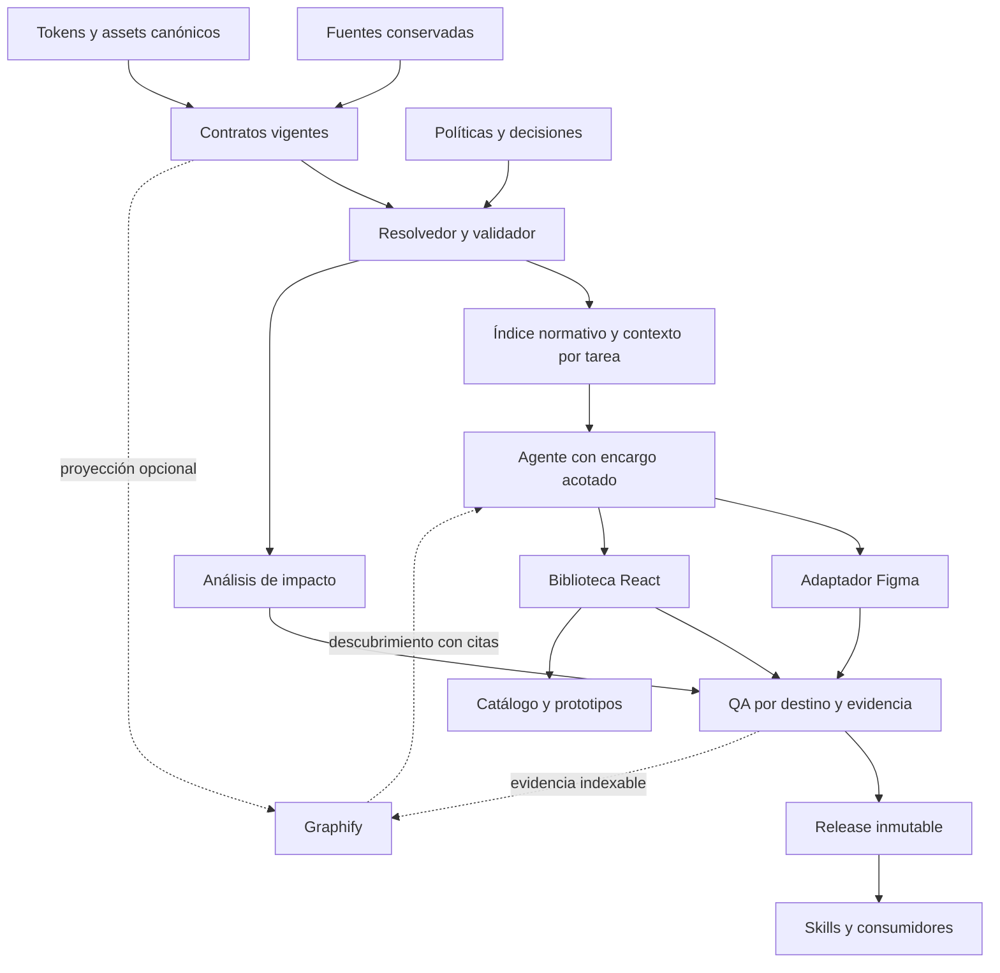

# Blue Heart DS · Arquitectura propuesta

Fecha: 26 de octubre de 2026 · Estado: propuesta para discusión, sin código ni decisiones adoptadas automáticamente.

Se apoya en [el diagnóstico](</Users/miguel.leo/Desktop/Blue Heart DS/auditoria/2026-10-26/01-diagnostico.md>). Las referencias H01–H13 corresponden a sus hallazgos.

**Recomendación:** un repositorio modular, con un núcleo determinista de contratos y dependencias, adaptadores separados para Figma y web, y agentes que operan sobre paquetes de contexto acotados. Graphify debe enriquecer la exploración sin controlar la disponibilidad de una versión normativa ya comprobada.

## 1. Decisiones arquitectónicas propuestas

| Decisión | Motivo | Coste o condición |
|---|---|---|
| Monorepo modular inicialmente | Permite cambios coordinados de contrato, tokens y adaptadores sin añadir servicios. | Los límites de módulos deben verificarse; reorganizar carpetas no basta. |
| Contrato vigente resoluble por identidad, versión y destino | Evita que cada agente reconstruya precedencia a partir de historia. | Requiere migrar relaciones y enmiendas con trazabilidad. |
| Markdown para redacción; metadatos estructurados validados | Conserva legibilidad y reduce migración innecesaria. | No todo el lenguaje natural es verificable automáticamente. |
| Tokens y assets con un propietario único | Evita tomar datos de scripts históricos o duplicarlos en documentos. | Mantener referencias y equivalencias explícitas durante la transición. |
| Índice normativo determinista | Las consultas básicas dependen de relaciones y datos verificables. | Demostrar cobertura frente al índice actual y revisión independiente de casos críticos. |
| Graphify como adaptador opcional | Desacopla exploración semántica de validación/distribución. | Puede perderse descubrimiento útil; conservarlo si pruebas de tareas lo justifican. |
| Biblioteca React separada del catálogo | El producto reutilizable deja de depender de copiar estructura de una aplicación Next. | Definir exports, assets, estilos y compatibilidad. |
| Motores de skills independientes del contenido | El original ya avanza en esta dirección; vale la pena preservarla. | Protocolo de compatibilidad explícito y pruebas de consumidores. |
| Roles de agentes bajo demanda | Reduce contexto repetido y coordinación innecesaria. | Revisor distinto del autor en cambios críticos; no sustituirlo por cambio de nombre. |
| Evidencia por corte y alcance | Permite reusar QA sin presentar un PASS histórico como actual. | Deben conocerse las dependencias que invalidan cada comprobante. |

No se recomienda introducir de inicio microservicios, una base de datos de grafos, un vector store, un bus de mensajes, Kubernetes ni agentes persistentes. La evidencia disponible no demuestra que sean necesarios para este tamaño y uso del sistema.

## 2. Límites de los módulos

Los nombres siguientes describen responsabilidades futuras; **no se crearon estas carpetas**.

| Módulo lógico | Posee | Puede depender de | No debe poseer |
|---|---|---|---|
| Gobierno | Políticas de autoridad, alcance, publicación y decisiones | Evidencia citada | Valores de componentes o estado duplicado de QA |
| Contratos | Identidad, requisitos, variantes, comportamiento, composición, aceptación y dependencias | Tokens, assets y otros contratos por versión | IDs mutables del archivo Figma como identidad del dominio |
| Tokens y assets | Valores, aliases, modos, unidades, descripciones y bytes de artwork | Fuentes con procedencia | Reglas de producto inferidas por apariencia |
| Núcleo de herramientas | Inventario, validación, resolución, impacto y contexto | Contratos y esquemas | API de Figma, Graphify o Next como requisito para validar norma |
| Adaptador Figma | Binding lógico→destino, plan, lectura, escritura y comprobantes | Núcleo y capacidades reales del proveedor | Norma nueva creada para acomodar la herramienta |
| Biblioteca web | API React, estilos, semántica HTML y adaptaciones documentadas | Contratos, tokens y assets | Catálogo Next o generadores Graphify en runtime |
| Catálogo y prototipos | Documentación, ejemplos y exportación de demos | Biblioteca web y metadatos derivados | Otra definición editable de tokens o contratos |
| Skills | Routing de tareas y adaptación al entorno del agente | API de contexto y adaptadores | Copias manuales de la política normativa |
| Evidencia y releases | Manifiestos, resultados, snapshots necesarios y artefactos inmutables | Entradas identificadas por hash | Un segundo estado normativo editable |
| Navegación | Índices de consulta; Graphify cuando aporte valor | Fuentes y comprobantes | Poder para aprobar contratos o modificar su precedencia |

No hay flecha de Graphify hacia el resolvedor normativo. Una relación inferida puede sugerir una inspección; solo una fuente o decisión válida puede incorporarla al modelo normativo.

## 3. Modelo de autoridad y contrato SDD

### Un propietario por dato

Se propone mantener **un archivo de contrato Markdown por entidad y versión**, con frontmatter validado. El cuerpo contiene requisitos y razones que necesitan lenguaje natural. No se propone mantener a mano el mismo contrato completo en Markdown y YAML/JSON.

Los datos que sí necesitan estructura tienen propietario explícito: inventario de tokens, matriz de variantes, registro de assets o contrato de comportamiento cuando sea suficientemente complejo. El contrato referencia esos datos por identidad y hash. Una representación JSON para herramientas es generada y no editable. Si el perfil requiere reglas estructuradas extensas, pueden residir en un archivo complementario propio, sin repetirlas normativamente en el Markdown.

| Información | Regla propuesta |
|---|---|
| Identidad | ID estable independiente de nombre de archivo, marca o página Figma. |
| Versionado | Versión de contrato distinta de versión del esquema, del adaptador y del release. |
| Tipo/perfil | Foundation, componente, composición, patrón o comportamiento; campos mínimos por tipo. |
| Requisitos | ID estable, texto normativo, fuerza, alcance/destino, procedencia y aceptación asociada. |
| Dependencias | Relación tipada: composición, token, asset, comportamiento o referencia informativa. |
| Cambios | Requisitos añadidos, sustituidos o retirados de manera explícita; conflictos detectables. |
| Evidencia | Referencia al snapshot, dato o decisión, sin convertir evidencia observada en norma automáticamente. |
| Destinos | Figma y web como perfiles; una familia puede estar lista en uno y pendiente en otro. |
| Excepciones | Alcance, motivo, autoridad y condición de revisión; jamás un PASS global que oculte la diferencia. |

Las 21 secciones del original son una buena lista de temas, pero no deben ser un documento obligatorio idéntico para cada tipo. Se propone conservar un perfil completo para componentes complejos y perfiles más pequeños para tokens, assets y composiciones. Quitar una sección vacía no debe quitar un requisito de accesibilidad o comportamiento necesario.

### Vigencia e historia

Una entrada por identidad apunta al corte elegible. El resolvedor produce una **vista efectiva** con cada requisito vigente y su procedencia. No elige “la última fecha”, no deduce sustitución por mayor versión y no fusiona párrafos ambiguos mediante un LLM.

Durante la migración, una enmienda expresada solo en prosa necesita normalización revisada. Si no se puede resolver de forma inequívoca, la vista muestra el conflicto y bloquea ese alcance. Una vez consolidada una versión, el consumidor utiliza esa versión y consulta el historial solo para auditoría o cambio.

Las relaciones históricas de Button, la sustitución de cantidades de Select por Slots y la excepción tipográfica de herencia son pruebas obligatorias del resolvedor: una simplificación que las pierda no es aceptable.

### Estados separados

| Dimensión | Qué debe expresar |
|---|---|
| Estado documental | Candidato, en revisión, elegible o sustituido. |
| Autoridad | Aprobación explícita o delegación técnica, con fuente y alcance. |
| Preparación por destino | Listo, bloqueado o conflicto. |
| Resultado QA | PASS, FAIL, BLOCKED, NOT_RUN o NOT_APPLICABLE por control. |
| Vigencia del QA | Si corresponde a los hashes y dependencias actuales. |
| Publicación | Preparado, autorizado, publicado y verificado, como hechos distintos. |

Los nombres finales pueden preservar los actuales para facilitar compatibilidad. La mejora es hacer explícita su dimensión y su evidencia, no cambiar etiquetas por estética. Las autorizaciones históricas del original no se trasladan automáticamente a Blue Heart.

## 4. Contexto de agentes y navegación

El núcleo debe resolver una consulta en tres niveles:

1. **Localización:** identidad, versión, estado, resumen factual, requisitos relevantes y rutas. Sin cuerpos históricos completos.
2. **Contexto de trabajo:** requisitos, tokens y dependencias realmente necesarios para el encargo, con citas exactas.
3. **Evidencia ampliada:** snapshots, enmiendas históricas y comprobantes solo cuando una verificación o conflicto lo necesita.

Cada paquete de contexto identifica corte, pregunta, alcance cubierto, exclusiones, fuentes/hashes, herramientas y presupuesto utilizado. Si el presupuesto impide incluir una dependencia necesaria, debe indicar incompletitud y permitir ampliación; nunca truncar y declarar que está completo.

Un contrato consolidado puede ser resumido para orientación, pero las obligaciones exactas deben poder recuperarse por ID. El agente no debería resolver un cambio obligatorio usando solo un resumen narrativo.

**Objetivos iniciales propuestos para el piloto, no ahorros prometidos:** entrada de orientación de hasta 12 KiB y paquete normal por familia de hasta 64 KiB; ampliar cuando lo justifique el alcance. Estos umbrales se calibran contra tareas reales y no sustituyen cobertura. Medir bytes retornados y tokens cuando el runtime los exponga. No usar una conversión fija bytes→tokens como dato observado.

Graphify puede conservarse para preguntas abiertas, relaciones históricas y navegación conceptual. Su evaluación debe comparar éxito de tarea, requisitos omitidos, lecturas, coste de mantenimiento y tiempo de recuperación frente a búsqueda literal e índice determinista. Un grafo más pequeño o una consulta más rápida no bastan si empeora la respuesta.

## 5. Arquitectura de agentes

| Responsabilidad | Activación | Entregable | Permisos mínimos |
|---|---|---|---|
| Coordinación | Cada encargo | Alcance, ruta de ejecución, integración y cierre | Lectura; escritura solo donde el encargo la autorice. |
| Análisis de dominio/contrato | Ingesta, conflicto o cambio normativo | Candidato y matriz fuente→requisito | Fuentes en lectura y borradores autorizados. |
| Construcción por destino | Implementación solicitada | Plan, resultado y comprobantes | Un destino autorizado; sin publicación implícita. |
| Verificación independiente | Cambios de alto impacto o de política/flujo | Cobertura, defectos y decisión técnica | Lectura y ejecución de pruebas acotadas; sin redefinir requisitos. |
| Optimización | Problema medido y encargo separable | Experimento comparable | Benchmark; cambios solo dentro del alcance concedido. |

Eva/Atlas/Bruno/Vera/Iris pueden mantenerse como nombres de interfaz. La arquitectura debe funcionar por capacidades y entregables, sin depender del nombre ni de un ID de proceso histórico.

Un encargo delegado incluye objetivo, entradas exactas, rutas/destinos permitidos, prohibiciones, dependencias, criterio de aceptación y condición de parada. El resultado incluye cambios, pruebas, evidencia, límites y siguiente acción. Evitar copiar toda la conversación; transferir el manifiesto de tarea y abrir las fuentes requeridas.

Las tareas independientes de lectura pueden paralelizarse si está autorizado. Las escrituras sobre un mismo recurso tienen un propietario: archivo contractual, conjunto Figma o puntero de release. No extender innecesariamente ese bloqueo a todas las tareas de lectura. Los resultados de ejecución y QA deben registrarse automáticamente cuando existan, sin exigir conversaciones ceremoniales entre perfiles.

La oficina visual sería una vista de trabajos reales. Su continuidad, cancelación y recuperación deben probarse antes de hacerla la entrada principal. Inicialmente basta una interfaz de comandos y comprobantes legibles; el diseño no presupone un servicio permanente.

## 6. Figma, web y prototipos

**Figma.** El adaptador recibe un contrato resuelto y un destino explícito. Resuelve capacidades, lee estado, calcula diferencias, prepara lotes y verifica cada resultado. Mantiene un mapa por archivo de IDs lógicos a IDs/key reales. Debe detectar que una operación ya se aplicó y no duplicarla; ante una interrupción, reconstruir el estado desde lectura y diario. No se promete rollback universal: las operaciones compensatorias se especifican y prueban por capacidad.

La organización “una página por familia” se trata como una política de presentación de la biblioteca, no como identidad del componente. Puede mantenerse si ayuda a los diseñadores; el modelo no debe dejar de funcionar al cambiar esa organización. Slots y escalas heredadas tienen pruebas propias y no se abstraen hasta perder sus restricciones.

**Web.** La biblioteca React posee exports, tipos, semántica HTML y estilos. El catálogo Next es un consumidor opcional; los clientes no requieren Graphify, Ruby ni acceso a Figma para ejecutar la biblioteca. Tokens y assets llegan como artefactos versionados con rutas configurables. Los componentes de producto —por ejemplo chat especializado— se distinguen de primitivas compartidas para que su cambio no invalide todo el DS.

**Prototipos.** Se preserva la entrega autónoma offline y el handoff verificable. La elección del compilador se evalúa aparte del framework del catálogo. No hay evidencia para cambiar Next únicamente por preferencia; sí para comparar el exportador actual con un flujo estático más simple en un prototipo representativo.

El handoff debe tener un manifiesto estructurado único: corte DS, instancias, props, estilos, composición, pantallas, estados, transiciones, decisiones locales y evidencia. Markdown y capturas son vistas complementarias del mismo resultado. Un handoff no asigna IDs Figma inexistentes ni certifica la implementación del destino.

## 7. Distribución y reproducibilidad

Separar cuatro identidades: esquema del contrato, corte del contenido DS, versión de biblioteca/adaptador y versión de motor de skill. Las skills se actualizan cuando cambia su protocolo o comportamiento; un dato compatible no obliga a reinstalarlas.

Dos modos explícitos de consumo:

- **Fijado:** usa una versión/hashes ya verificados; puede operar offline si están todos los artefactos requeridos. Informa que el corte está fijado, sin afirmar que sea el más reciente.
- **Canal actual:** consulta el puntero y fija el resultado al comenzar el trabajo. Una actualización posterior no altera la tarea en curso.

La publicación prepara artefactos inmutables, verifica integridad y compatibilidad, y cambia el puntero al final. El comprobante registra commit limpio o snapshot de contenido, hashes de herramientas y gates aplicables. No repetir compilaciones si sus entradas son idénticas y el comprobante es válido.

Un perfil ligero de consumo incluye norma efectiva, tokens, API y assets necesarios; el perfil de mantenimiento incluye historia y evidencia. La caché conserva objetos por hash. La elección entre bundle único y paquetes parciales se decide con mediciones de red e I/O: fragmentar prematuramente puede empeorar la latencia.

Los hashes acreditan contenido, no identidad del publicador. La confianza en origen, permisos y canal de publicación debe declararse. No hace falta añadir una infraestructura de firmas sin un requisito, pero tampoco presentar un digest como autenticación independiente.

## 8. Automatización y QA proporcionales

| Cambio | Controles principales | Invalidación prevista |
|---|---|---|
| Corrección editorial sin norma | Sintaxis, enlaces y diferencia semántica revisada | Documentación afectada; sin regenerar implementaciones. |
| Requisito/API de componente | Contrato, compatibilidad, tests y ejemplos de consumidores | Familia y dependientes transitivos tipados. |
| Token compartido | Alias/ciclos/unidades/modos y consumidores | Todas las referencias afectadas, incluyendo Figma/web. |
| Artwork | Hash, procedencia, dimensiones y consumo | Assets y componentes que lo utilizan. |
| Adaptador Figma | Pruebas de capacidades, preservación, reintento y readback | Operaciones cuya traducción cambió. |
| Motor de skill | Routing, contexto, protocolo y entrega | Skills afectadas; contenido DS permanece fijado. |
| Grafo exploratorio | Fuentes, procedencia e integridad de su proyección | Índice exploratorio; no invalida por sí solo un release normativo. |

El criterio de release es completitud de los gates aplicables, no “todos los módulos han corrido”. La revisión de alto impacto debe ejecutarse con las fuentes y criterios originales para evitar que autor y revisor validen el mismo resumen erróneo.

## 9. Alternativas descartadas o condicionadas

- **Copiar y simplificar AGENTS únicamente:** no elimina dependencia de Graphify ni dispersión contractual.
- **Convertir todo a JSON/YAML inmediatamente:** añade migración y riesgo de pérdida de significado antes de tener un esquema probado. Se normaliza primero el mínimo estructural y la resolución.
- **Hacer Figma la única fuente de verdad:** no representa por sí solo intención de producto, teclado, accesibilidad o reglas de web.
- **Eliminar Graphify:** se condiciona a medir utilidad; la propuesta elimina su obligatoriedad para el núcleo, no su posible valor.
- **Un agente por rol siempre:** la separación de responsabilidades no obliga a multiplicar ejecuciones.
- **Reescribir todos los componentes:** no está justificado mientras código y pruebas existentes puedan adaptarse a un límite de paquete limpio.
- **Cambiar nombres/tokens por la nueva marca:** requiere una decisión de producto; arquitectura nueva no autoriza alterar identidad visual.

El diseño favorece una evolución verificable: primero estabilizar autoridad, resolución y evidencia; después modularizar implementación y distribución; finalmente añadir automatización cuya utilidad se haya medido.
